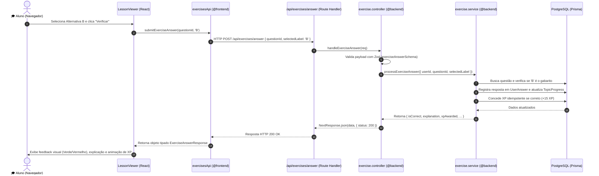

# 🏛️ Guia de Arquitetura: Divisão Frontend & Backend — CTFL Academy

Bem-vindo ao guia de arquitetura do **CTFL Academy**! Este documento foi elaborado para fins de estudo e referência na construção, evolução e realização de testes da plataforma.

---

## 🎯 1. Filosofia e Visão Geral da Arquitetura

O projeto utiliza uma **Arquitetura Modular em Três Camadas (Clean Layered Architecture)** sobre o ecossistema Next.js 14 (App Router). 

A separação é organizada para garantir:
1. **Desacoplamento Claro:** O frontend não acessa o banco de dados diretamente; ele se comunica exclusivamente através de clientes de API tipados (`@frontend/api-clients`).
2. **Lógica de Negócio Isolada:** O backend centraliza todas as regras de domínio (Gamificação, Algoritmo SM-2 de repetição espaçada, Motor de simulados da matriz oficial CTFL) em serviços puros (`@backend/services`), independentes do framework web.
3. **Testabilidade Total:** É possível testar cada camada separadamente: testes unitários de regras puras, testes de integração de API/controllers, e testes de componentes/clientes frontend.

```mermaid
graph TD
    subgraph Frontend ["🎨 Camada Frontend (@frontend)"]
        UI["Componentes React (LessonViewer, FloatingNotebook, etc.)"]
        Clients["Clientes de API Tipados (@frontend/api-clients)"]
        UI --> Clients
    end

    subgraph HTTP ["🌐 Camada de Roteamento HTTP (src/app/api)"]
        Routes["Thin Route Handlers (/api/exercises/answer, /api/notes, etc.)"]
        Clients -->|HTTP Fetch (JSON)| Routes
    end

    subgraph Backend ["⚙️ Camada Backend (@backend)"]
        Controllers["Controllers (Validação Zod & HTTP Status)"]
        Middlewares["Middlewares (requireAuth, rateLimit)"]
        Services["Domain Services (ExamService, SpacedRepetition, Gamification)"]
        DB["Acesso a Dados (Prisma ORM & Caches)"]

        Routes --> Controllers
        Controllers --> Middlewares
        Controllers --> Services
        Services --> DB
    end

    subgraph Storage ["💾 Banco de Dados"]
        Postgres[(PostgreSQL)]
        DB --> Postgres
    end

    subgraph Shared ["📦 Camada Compartilhada (@shared)"]
        Types["Tipos TypeScript (DTOs, Entidades)"]
        Schemas["Schemas Zod de Validação"]
        Constants["Constantes Oficiais (Matriz CTFL, Regras XP)"]

        Shared -.-> Frontend
        Shared -.-> Backend
    end
```

---

## 📂 2. Estrutura de Pastas e Responsabilidades

### `src/shared/` — Contratos e Definições Compartilhadas
Tudo o que precisa ser conhecido **tanto pelo Frontend quanto pelo Backend**:
- **`@shared/types/`**: Interfaces TypeScript de contratos de dados (ex: `notebook.ts`, `api.ts`).
- **`@shared/validations/`**: Schemas Zod reutilizados tanto na validação de formulários da interface quanto na validação de payloads nas rotas de API.
- **`@shared/constants/`**: Regras de pontuação de XP (`XP_RULES`), Matriz oficial de questões por capítulo do ISTQB CTFL (`CTFL_OFFICIAL_DISTRIBUTION`), etc.
- **`@shared/utils/`**: Formatadores utilitários (tempo, datas padrão pt-BR, mescla de classes CSS `cn`).

### `src/backend/` — Núcleo de Negócio e Serviços de Servidor
- **`@backend/services/`**: O coração das regras da aplicação.
  - `exam-engine.service.ts`: Algoritmo Fisher-Yates de seleção balanceada de 40 questões por matriz de capítulo, sem repetição e sem vazamento de gabarito.
  - `exam.service.ts`: Gerenciamento do ciclo de vida de provas e timer estrito do servidor.
  - `gamification.service.ts`: Cálculo de sequência de estudos (streak) e concessão idempotente de XP.
  - `spaced-repetition.service.ts`: Algoritmo SuperMemo SM-2 adaptado para os flashcards (Fácil, Médio, Difícil).
  - `question-workflow.service.ts`: Máquina de estados editorial de questões (`DRAFT` ➔ `IN_REVIEW` ➔ `PUBLISHED` / `REJECTED`).
  - `notes.service.ts`: Gerenciamento de notas de estudo, mapas mentais e conversão em flashcards.
- **`@backend/controllers/`**: Handlers HTTP intermediários. Eles recebem o request, validam o body com Zod, invocam o Service apropriado e devolvem `NextResponse.json(...)` com status adequados (200, 201, 400, 404, 500).
- **`@backend/middlewares/`**: Funções de proteção (`requireAuth`, `requireAdmin`, `checkRateLimit`).
- **`@backend/db/`**: Instância do cliente Prisma (`prisma.ts`) e caches de memória (`curriculum-cache.ts`).

### `src/frontend/` — Camada de Apresentação e Clientes
- **`@frontend/api-clients/`**: Camada que encapsula todas as chamadas `fetch` para a API:
  - `exercises.api.ts`: `submitExerciseAnswer(questionId, selectedLabel)`
  - `flashcards.api.ts`: `submitFlashcardReview(...)`, `resetFlashcardProgress(...)`
  - `notes.api.ts`: `fetchNotes(...)`, `createNote(...)`, `convertNoteToFlashcard(...)`
  - `lessons.api.ts`: `markLessonComplete(lessonId)`
  - `auth.api.ts`: `loginUser(...)`, `registerUser(...)`, `logoutUser()`, `getMe()`
- **`@frontend/components/`**: Componentes de interface do usuário (`ui/`, `student/`, `admin/`, `layout/`).

### `src/app/api/` — Rotas Finas (Delegates)
No Next.js 14 App Router, os arquivos `src/app/api/**/route.ts` funcionam apenas como **portas de entrada HTTP finas**. Eles não contêm regras de negócio nem SQL/Prisma direto; apenas delegam para os controllers em `@backend/controllers/`.

---

## 🔄 3. Ciclo de Vida de uma Operação (Exemplo Real)

Veja o que acontece quando o aluno clica em **"Verificar Resposta"** em um exercício:



---

## 🧪 4. Guia Prático de Testes

A suíte de testes foi estruturada com o **Vitest** para permitir testes extremamente rápidos e segmentados.

### Comandos de Teste no `package.json`:

| Comando | O que executa | Tempo Típico |
| :--- | :--- | :--- |
| `npm run test` | **Todos os testes** do projeto (unitários, api e integração) | ~2.5s |
| `npm run test:unit` | Todos os testes unitários (front e back) | ~1.0s |
| `npm run test:backend` | Testes de domínio, serviços e persistência | ~1.5s |
| `npm run test:frontend` | Testes dos clientes de API e formatadores de UI | ~0.9s |
| `npm run test:api` | Testes diretos dos controllers e rotas da API | ~1.1s |
| `npm run test:integration` | Testes com banco de dados real PostgreSQL | ~0.5s |
| `npm run test:watch` | Modo interativo do Vitest para TDD | Contínuo |
| `npm run test:e2e` | Testes ponta a ponta reais com Playwright | Variável |

---

### 📝 Exemplos Didáticos de Como Escrever Testes

#### 1. Teste Unitário de Backend (`tests/unit/backend/`)
Testa a lógica de negócio pura, sem depender de banco de dados ou requisições HTTP:

```ts
import { describe, it, expect } from 'vitest';
import { computeNextFlashcardReview } from '@/backend/services/spaced-repetition.service';

describe('Spaced Repetition SM-2', () => {
  it('reinicia para 1 dia e reduz facilidade quando classificado como HARD', () => {
    const result = computeNextFlashcardReview({
      rating: 'HARD',
      previousIntervalDays: 10,
      previousEaseFactor: 2.5,
      previousRepetitions: 3,
    });

    expect(result.intervalDays).toBe(1);
    expect(result.repetitions).toBe(1);
    expect(result.state).toBe('LEARNING');
    expect(result.easeFactor).toBe(2.3);
  });
});
```

#### 2. Teste de Controller / Rota de API (`tests/api/`)
Testa se o endpoint valida parâmetros e responde com o status HTTP correto:

```ts
import { describe, it, expect } from 'vitest';
import { handleExerciseAnswer } from '@/backend/controllers/exercise.controller';

describe('Exercise API Controller', () => {
  it('retorna HTTP 400 quando a alternativa for inválida', async () => {
    const fakeRequest = new Request('http://localhost:3000/api/exercises/answer', {
      method: 'POST',
      headers: { 'Content-Type': 'application/json' },
      body: JSON.stringify({ questionId: 'q-1', selectedLabel: 'LETRA_INVALIDA' }),
    });

    const response = await handleExerciseAnswer(fakeRequest);
    expect(response.status).toBe(400);

    const json = await response.json();
    expect(json.error).toBe('Dados de resposta inválidos.');
  });
});
```

#### 3. Teste Unitário de Frontend (`tests/unit/frontend/`)
Testa clientes de API e formatadores simulando respostas com mocks:

```ts
import { describe, it, expect, vi } from 'vitest';
import { submitExerciseAnswer } from '@/frontend/api-clients/exercises.api';

describe('Frontend API Client', () => {
  it('envia a requisição HTTP correta e retorna a resposta tipada', async () => {
    global.fetch = vi.fn().mockResolvedValue({
      ok: true,
      headers: new Headers({ 'content-type': 'application/json' }),
      json: async () => ({ isCorrect: true, xpAwarded: 15 }),
    });

    const result = await submitExerciseAnswer('questao-42', 'A');
    expect(result.isCorrect).toBe(true);
    expect(result.xpAwarded).toBe(15);
  });
});
```

---

## 🚀 5. Como Adicionar uma Nova Funcionalidade (Passo a Passo)

Para criar um novo recurso (por exemplo, um sistema de **Metas Semanais de Estudo**):

1. **Definir Contratos (`src/shared/`):**
   - Crie os tipos em `src/shared/types/goals.ts`.
   - Crie o schema de validação Zod em `src/shared/validations/index.ts`.
2. **Criar a Regra de Negócio (`src/backend/services/`):**
   - Crie `src/backend/services/goal.service.ts` com as funções de cálculo e gravação no Prisma.
   - Crie um teste unitário em `tests/unit/backend/goals.service.test.ts`.
3. **Criar o Controlador HTTP (`src/backend/controllers/`):**
   - Crie `src/backend/controllers/goal.controller.ts` para receber requisições, validar inputs e chamar o serviço.
   - Crie um teste de API em `tests/api/goals.test.ts`.
4. **Criar a Rota Next.js (`src/app/api/`):**
   - Crie `src/app/api/goals/route.ts` delegando para o controller criado no passo 3.
5. **Criar o Cliente Frontend (`src/frontend/api-clients/`):**
   - Crie `src/frontend/api-clients/goals.api.ts` exportando funções como `saveWeeklyGoal(...)`.
6. **Consumir na Interface (`src/components/` ou `src/app/`):**
   - Use o cliente em seu componente React com total segurança de tipos e tratamento amigável de erros.
