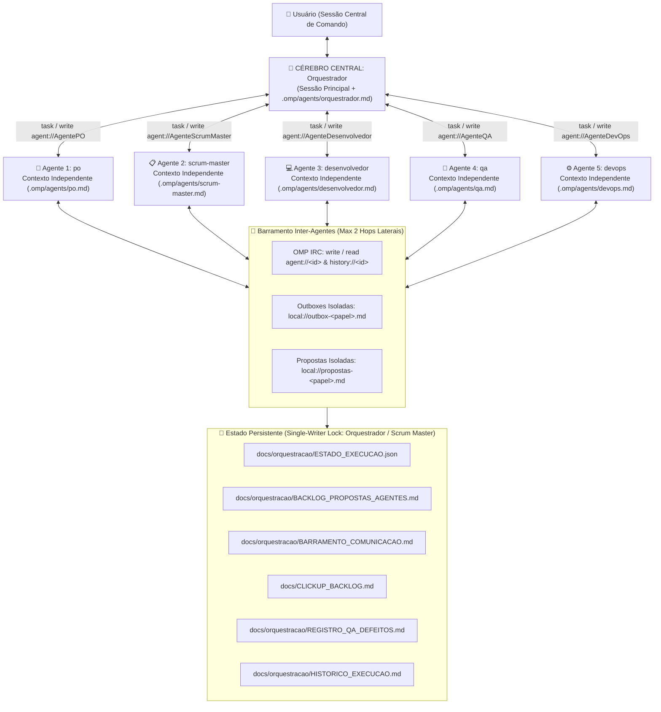

# Manual Operacional: Orquestração Autônoma com Cérebro Central e Agentes Independentes — CTFL Academy

**Versão:** 2.0.0 | **Data:** 2026-10-22  
**Escopo:** Sistema de orquestração multiagente autônomo dedicado exclusivamente ao **CTFL Academy** no **OMP (Oh My Pi)**.

---

## 1. Arquitetura do Cérebro Central e dos Cinco Agentes Independentes

### Papéis e Prioridades de Especialidade
1. **Cérebro Central (`orquestrador` — `.omp/agents/orquestrador.md` + Sessão Principal OMP):**
   - Ponto único de contato do usuário; interpreta ordens, seleciona e despacha agentes independentes, compara respostas, arbitra contradições e conflitos de prioridade, consolida sugestões espontâneas e gerencia checkpoints de pausa/retomada.
2. **Product Owner (`po` — `.omp/agents/po.md`):**
   - Prioriza **valor de produto e eficácia pedagógica** frente ao Syllabus ISTQB® CTFL v4.0.1.
3. **Scrum Master (`scrum-master` — `.omp/agents/scrum-master.md`):**
   - Prioriza **organização, fluidez do fluxo, remoção de gargalos, dependências e capacidade de execução**.
4. **Desenvolvedor (`desenvolvedor` — `.omp/agents/desenvolvedor.md`):**
   - Prioriza **simplicidade arquitetural, Clean Layered Architecture (`@shared`, `@backend`, `@frontend`, `src/app/api`), segurança e redução de dívida técnica**. Único agente autorizado a modificar código de aplicação (`src/`, `prisma/`).
5. **QA (`qa` — `.omp/agents/qa.md`):**
   - Prioriza **prevenção de defeitos (*shift-left*), testes reais, questionamento crítico de critérios de aceitação e evidências reproduzíveis**.
6. **DevOps (`devops` — `.omp/agents/devops.md`):**
   - Prioriza **confiabilidade de build, paridade entre ambientes (Local, CI/Homologação, Produção), automação de CI/CD e segurança operacional**.

---

## 2. Governança de Decisão em Três Níveis (Autonomia com Controle)

| Nível | Classificação | Regra Operacional |
|---|---|---|
| **Nível A** | **Sugestão (`A_SUGESTAO`)** | Qualquer um dos 5 agentes pode propor melhorias espontaneamente (`local://propostas-<papel>.md` $\rightarrow$ `BACKLOG_PROPOSTAS_AGENTES.md`). **Isso jamais autoriza implementação automática.** |
| **Nível B** | **Execução Autorizada (`B_EXECUCAO_AUTORIZADA`)** | Quando o usuário dá uma ordem clara de execução, a equipe executa autonomamente o **Ciclo Autônomo de 12 Etapas** até cumprir os critérios de aceitação, usando julgamento técnico para decisões reversíveis sem interromper o usuário a cada detalhe. |
| **Nível C** | **Decisão Reservada ao Usuário (`C_RESERVADA_AO_USUARIO`)** | Mudanças relevantes de escopo, decisões de produto de alto impacto, operações destrutivas, alterações irreversíveis, `git commit`/`git push` e publicação em produção exigem autorização explícita prévia do usuário. |

---

## 3. Ciclo Autônomo de Execução (12 Etapas)

1. **Interpretação do Objetivo** pelo Cérebro Central e registro em `ESTADO_EXECUCAO.json`.
2. **Consulta aos Agentes Relevantes** (`po`, `scrum-master` e especialistas técnicos).
3. **Decomposição em Subtarefas** e mapeamento de dependências.
4. **Distribuição aos Agentes Independentes** via `task` / `write agent://<id>`.
5. **Execução Paralela Segura** (caixas de saída isoladas `local://outbox-<papel>.md`; apenas `desenvolvedor` altera `src/` e `prisma/`).
6. **Reunião de Resultados e Resolução de Conflitos** pelo Cérebro Central.
7. **Validação Independente pelo QA** (requisitos, implementação e execução de testes reais).
8. **Ciclo de Correção Autônomo** (`qa` devolve falhas ao `desenvolvedor` $\rightarrow$ correção na causa raiz $\rightarrow$ reteste do `qa`).
9. **Validação de Build, Infraestrutura e Pipeline pelo DevOps** (`typecheck`, `lint`, `prisma validate`, `build`, CI).
10. **Verificação dos Critérios de Conclusão** (DoD do `scrum-master` + Aceite do `po`).
11. **Consolidação Atômica de Estado (`Single-Writer`)** em `ESTADO_EXECUCAO.json`, `HISTORICO_EXECUCAO.md`, `CLICKUP_BACKLOG.md`, `BARRAMENTO_COMUNICACAO.md` e `BACKLOG_PROPOSTAS_AGENTES.md`.
12. **Apresentação do Relatório Final** ao usuário, incluindo as sugestões espontâneas dos agentes.

---

## 4. Comandos e Rotinas da Sessão Central de Comando

Na conversa central com o Orquestrador, você pode usar comandos rápidos (`/`) ou frases diretas em linguagem natural:

| Objetivo na Sessão Central | Comando (`/`) | Exemplos em Linguagem Natural Suportados |
|---|---|---|
| **Planejamento Proativo (PO + SM)** | `/planejar [foco]` | *"Planejamento CTFL: consultem o projeto e me digam o que devemos fazer a seguir."* |
| **Executar Tarefa Autorizada (Ciclo de 12 Etapas)** | `/executar <tarefa>` | *"Executem a próxima tarefa prioritária aprovada."* ou *"Executem a tarefa CTFL-106."* |
| **Consultar Especialista Específico** | `/consultar <agente> <tema>` | *"QA, investigue os riscos do sistema de simulados e apresente suas recomendações ao orquestrador."* |
| **Debate Técnico / Produto entre Agentes** | `/debater <agentes e tema>` | *"Peça ao Desenvolvedor e ao DevOps para avaliarem juntos esta mudança arquitetural."* |
| **Reunir, Avaliar, Aceitar ou Rejeitar Propostas** | `/propostas [top5\|aceitar\|rejeitar]` | *"Reúnam as sugestões de todos os agentes e me apresentem as cinco mais importantes."* |
| **Pausar Execução e Preservar Checkpoint** | `/pausar [motivo]` | *"Pause a execução, preserve o estado atual e me mostre o que falta."* |
| **Retomar Tarefa Interrompida de Onde Parou** | `/retomar [tarefa]` | *"Retome a tarefa interrompida de onde parou."* |
| **Consultar Estado Global de Tarefas e Agentes** | `/status` ou `/backlog` | *"Mostre o estado atual de todas as tarefas, propostas e agentes."* |
| **Diagnóstico Somente-Leitura** | `/diagnostico [escopo]` | *"Façam uma auditoria completa sem alterar arquivos."* |
| **Correção Coordenada de Bug** | `/corrigir <bug>` | *"Corrijam o seguinte defeito com reprodução e reteste do QA: ..."* |
| **Inspecionar Subagentes ao Vivo (TUI)** | `Alt+A` ou `/agents` | Abre o **Agent Hub** nativo com status (`running`/`idle`/`parked`), transcrição e controle individual. |

---

## 5. Limitações Reais da Plataforma e Como Foram Mitigadas

1. **Ciclo de Vida de Processos quando o Terminal OMP é Fechado:**
   - **Limitação Real:** No OMP, os subagentes (`SpawnRun`) e seus timers de inatividade (`AgentLifecycleManager`) pertencem ao processo host do OMP (`unref()`). Quando o usuário encerra o processo do OMP, **nenhum processo de LLM permanece executando escondido em segundo plano**.
   - **Solução Implementada:**
     - **Mesma sessão ou sessão reaberta (`omp --continue` / `/resume`):** Todas as transcrições individuais `<session>/<AgentId>.jsonl` permanecem salvas em `~/.omp/agent/sessions/`; qualquer agente `idle` ou `parked` é reativado automaticamente via `write agent://<id>` mantendo 100% da memória.
     - **Nova sessão limpa:** O checkpoint atômico em **`docs/orquestracao/ESTADO_EXECUCAO.json`** e **`docs/orquestracao/HISTORICO_EXECUCAO.md`** registra exatamente `currentStep`, `completedSteps`, `pendingSteps` e `pausedState`, permitindo que `/retomar` continue da etapa exata onde parou sem refazer o trabalho anterior (e podendo consultar transcrições passadas via `agent: "seance"`).
2. **Prevenção de Corrupção em Execuções Simultâneas:**
   - Agentes em paralelo nunca escrevem simultaneamente no mesmo arquivo Markdown/JSON: cada agente escreve exclusivamente em `local://outbox-<papel>.md` e `local://propostas-<papel>.md`, e a escrita nos arquivos canônicos de `docs/` é serializada pelo *Single-Writer* (`orquestrador` / `scrum-master`).
